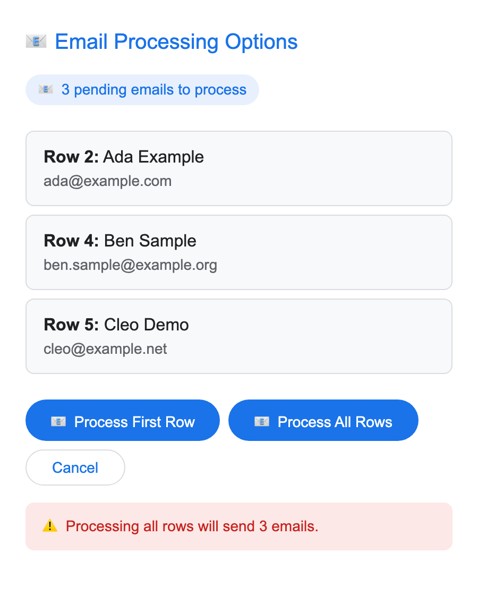
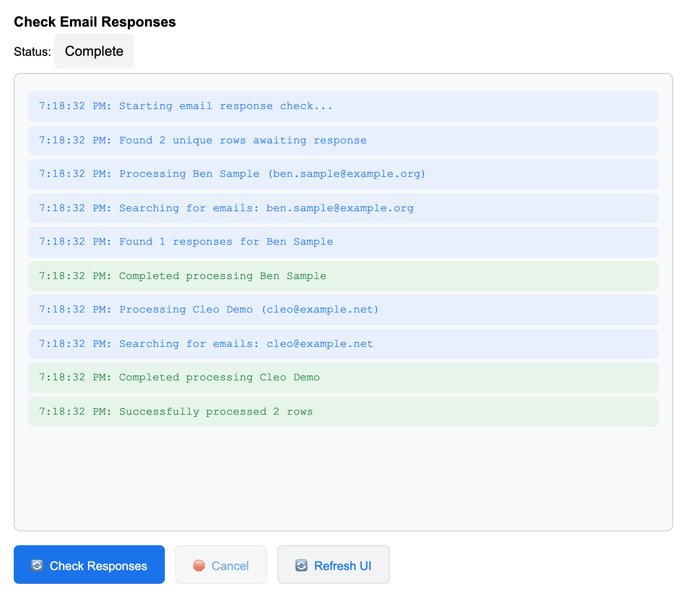

<div align="center">

<h1>Bulk Email Sender</h1>

<p><b>Mail merge and reply tracking in a Google Sheet.</b></p>

<p><i>Sending fifty personal emails is tedious. Remembering who wrote back, and when, is worse.</i></p>

<h6>


</h6>

<a href="#how-it-works"><b>How it works</b></a> ·
<a href="#features"><b>Features</b></a> ·
<a href="#set-it-up"><b>Set it up</b></a> ·
<a href="#sheet-layout"><b>Sheet layout</b></a>

<br><br>



<sub>The send dialog's own HTML from <code>email.gs</code>, rendered locally with made-up example.com rows.</sub>

</div>

<br>

## Why

Each person on a list gets their own email with their first name in it, sent from your own
Gmail. Then the sheet becomes the tracker: when each email went out, a link to the thread, and
every reply that came back, one per column. It is one `email.gs` file you paste into a
spreadsheet's Apps Script editor; there is no server and nothing to install.

## How it works

<table>
<tr>
<td width="33%" valign="top">

**1 · Mark the rows**

Put a name and address on each row and set the Action column to `Send Email`.

</td>
<td width="33%" valign="top">

**2 · Send**

**Email Manager > Send Emails...** lists the pending rows. Send the first one as a test, or
all of them. Each row gets its sent date, a Gmail link, and `Awaiting Response`.

</td>
<td width="33%" valign="top">

**3 · Check replies**

**Email Manager > Check Responses...** searches Gmail for each awaiting address since its sent
date and writes every later message into the row.

</td>
</tr>
</table>

## Checking for replies

<div align="center">



<sub>The response dialog from <code>email.gs</code>, rendered locally. Log lines are the script's own messages, with made-up rows.</sub>

</div>

The scan runs server-side and streams progress into the dialog through script properties,
so you can watch each address being searched and cancel part way.

## Features

- **Personalised HTML email.** `getEmailBody(firstName)` is a plain HTML template you edit; the name goes in the greeting.
- **Test with one row first.** The send dialog can process just the first pending row before you commit to the rest.
- **Status in the sheet.** A sent row gets a human-readable timestamp, a permalink to the Gmail thread and its Action flipped to `Awaiting Response`, so it is never sent twice.
- **Replies as cells.** Each reply lands in its own column from F onward: date, from, to, subject, the first 200 characters and a link.
- **A custom formula.** `=RECEIVEDEMAILSAFTERDATE(B2, D2)` lists messages from an address after a date, straight in a cell.
- **Errors stay on the row.** A bad address or missing name writes `Error: ...` into the Sent Date column instead of stopping the batch.

## Set it up

1. Make a Google Sheet and import [`sample_data.csv`](sample_data.csv) (**File > Import**, replace current sheet).
2. Open **Extensions > Apps Script**, replace `Code.gs` with the contents of [`email.gs`](email.gs) and save.
3. Edit the `CONFIG` block at the top:

   ```javascript
   const CONFIG = {
     SPREADSHEET_ID: 'YOUR_SPREADSHEET_ID_HERE', // the part of the sheet URL between /d/ and /edit
     SHEET_NAME: 'Sheet1',
     EMAIL_SUBJECT: 'Follow-up Request',
     SENDER_NAME: 'Your Name'
   };
   ```

4. Rewrite the placeholder letter in `getEmailBody`.
5. Run `setup` once from the editor and grant Sheets and Gmail access. To use the custom
   formula, also run `authorizeGmail`.
6. Reload the sheet; the **📧 Email Manager** menu appears.

Try it on your own address first. Apps Script caps how many recipients a day a consumer Gmail
account can send to, and a single run stops after six minutes.

<details>
<summary><b id="sheet-layout">Sheet layout</b></summary>

| Column | Holds | Written by |
|---|---|---|
| A | First name (used in the greeting) | you |
| B | Email address | you |
| C | Action: `Send Email`, `Awaiting Response` or empty | you, then the script |
| D | Sent date, or `Error: ...` | the script |
| E | Gmail link to the sent thread | the script |
| F onward | One reply per cell | Check Responses |

Rows with any other Action are skipped. Rows awaiting a response are de-duplicated by address
before the scan.

</details>

<details>
<summary><b>Functions you can run from the editor</b></summary>

| Function | |
|---|---|
| `setup` | Triggers the permission prompt for Sheets and Gmail |
| `authorizeGmail` | Marks Gmail as authorised so the custom formula will run |
| `onOpen` | Adds the Email Manager menu (runs automatically) |
| `forceStopProcess` | Clears a stuck "already running" flag |
| `resetEmailStatus(index)` | Clears a row's sent date and link and sets it back to `Send Email` (0-based data index) |
| `testEmailResponseCheck` | Runs the reply search for awaiting rows and only logs what it finds |
| `testReceivedEmailsFunction` | Calls the custom formula with a sample address and logs the result |

</details>

<br>

<div align="center">
<sub>Built with Google Apps Script, GmailApp and SpreadsheetApp. One file, MIT licensed.</sub>
</div>
